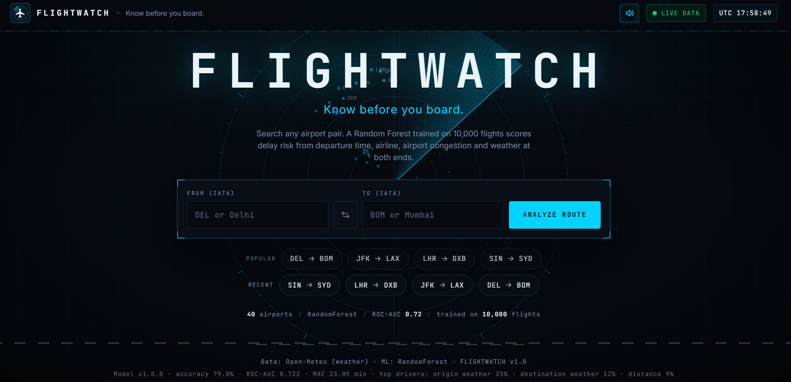
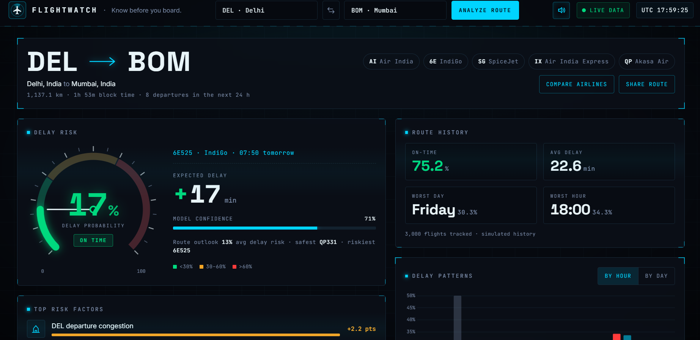
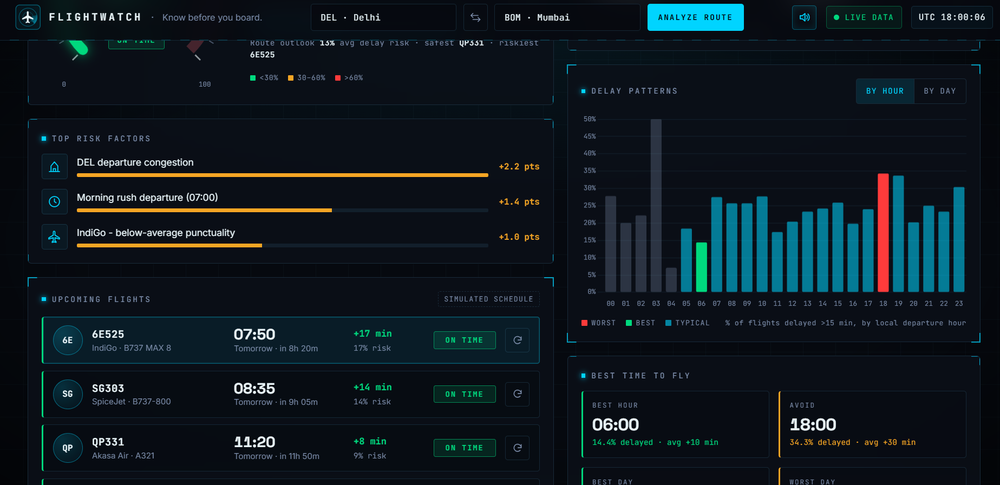
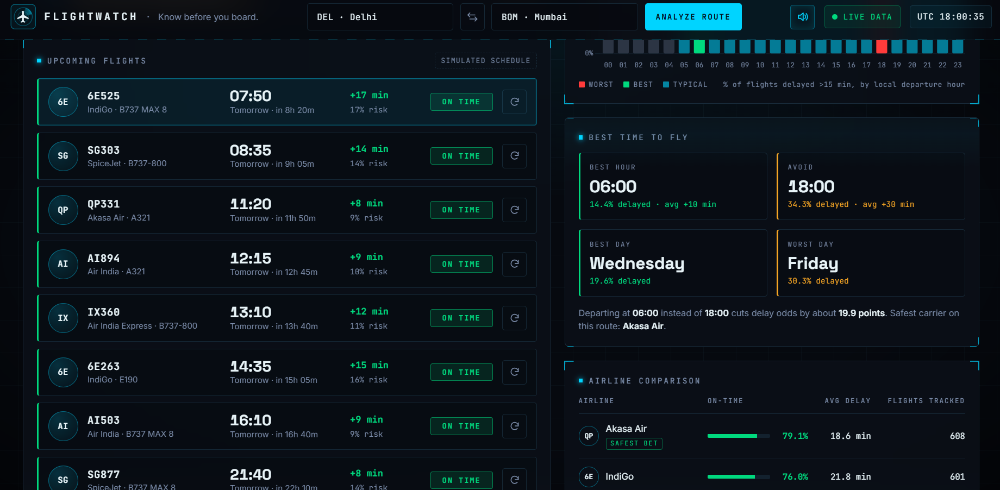
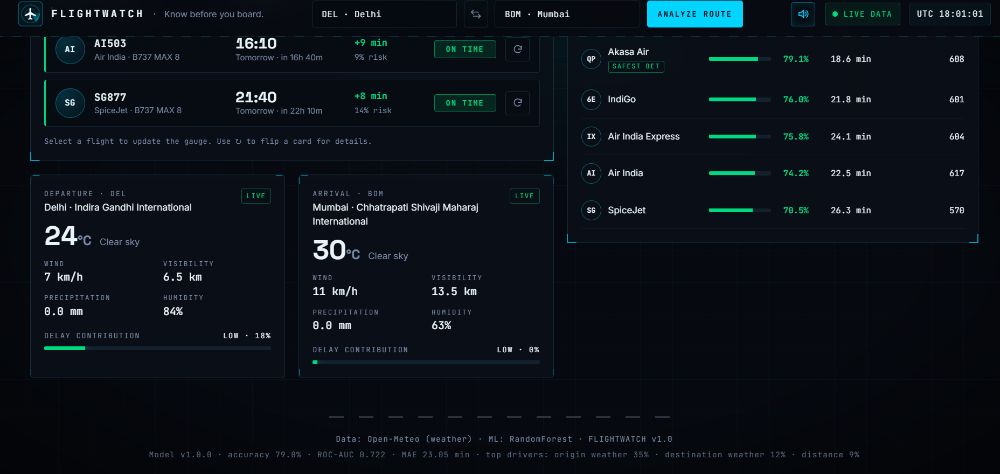
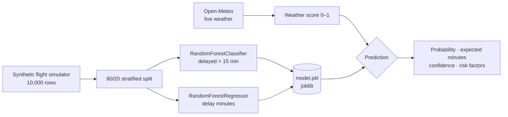

<div align="center">

<br>

# ✈ F L I G H T W A T C H

### *Know before you board.*

**ML-powered flight delay prediction with a mission-control interface.**
Pick any airport pair. Get a delay probability, the reasons behind it, live weather at both ends, and how the route has behaved historically.

<br>


[Screenshots](#-screenshots) · [Features](#-features) · [How the ML works](#-how-the-ml-works) · [Run it](#-run-locally) · [Deploy](#-deployment) · [API](#-api-reference)

<br>

</div>

---

## 📸 Screenshots

<div align="center">

**Radar landing page** — all 40 airports plotted on a real map projection, lighting up as the sweep passes



<br><br>

**Delay gauge, route history and risk factors**



<br><br>

<table>
  <tr>
    <td width="50%" align="center"><b>Risk factors and hourly delay pattern</b><br><br></td>
    <td width="50%" align="center"><b>Flights and best time to fly</b><br><br></td>
  </tr>
</table>

<br>

**Live weather at both airports and airline comparison**



</div>

---

## ✨ Features

<table>
  <tr>
    <td width="33%" valign="top">
      <h4>🎯 Delay-risk gauge</h4>
      Animated needle and fill. <b>Green</b> under 30%, <b>amber</b> 30–60%, <b>red</b> over 60%, with expected delay in minutes and a model-confidence bar.
    </td>
    <td width="33%" valign="top">
      <h4>🔍 Explainable factors</h4>
      Every flight shows its top 3 risk drivers, such as <i>"Evening departure (peak hour)"</i> or <i>"Weather at DEL: Fog"</i>, with the percentage-point impact of each.
    </td>
    <td width="33%" valign="top">
      <h4>🛫 Upcoming flights</h4>
      Eight departures per route with status (ON TIME / AT RISK / DELAYED). Click a flight to update the gauge, or flip the card for weather and timing details.
    </td>
  </tr>
  <tr>
    <td valign="top">
      <h4>🌦 Weather at both ends</h4>
      Open-Meteo data scored at each flight's <b>scheduled</b> departure and arrival hour. Falls back to a climatology estimate if the API is unreachable.
    </td>
    <td valign="top">
      <h4>📊 Historical patterns</h4>
      Delay rate by hour and by weekday. Worst bar in red, best in green, plus a <b>Best time to fly</b> panel.
    </td>
    <td valign="top">
      <h4>🏆 Airline comparison</h4>
      On-time %, average delay and flights tracked per carrier, with a <b>Safest bet</b> badge. Filter the flight list by airline.
    </td>
  </tr>
  <tr>
    <td valign="top">
      <h4>📡 Radar landing</h4>
      Airports plotted on an azimuthal projection. Hover a suggestion and its blip lights up; pick two and the route is drawn.
    </td>
    <td valign="top">
      <h4>🔗 Shareable routes</h4>
      Every analysis has a URL like <code>?from=DEL&amp;to=BOM</code>. One click copies it.
    </td>
    <td valign="top">
      <h4>🎛 Details that matter</h4>
      Live UTC clock, data-source indicator, optional sound alert on elevated risk (off by default), keyboard navigation, responsive layout, reduced-motion support.
    </td>
  </tr>
</table>

---

## 🛠 Tech stack

| Layer | Technology |
|:--|:--|
| **Backend** | Python 3.11+, FastAPI, uvicorn, Pydantic v2 |
| **Machine learning** | scikit-learn (`RandomForestClassifier` + `RandomForestRegressor`), pandas, numpy, joblib |
| **Weather** | [Open-Meteo](https://open-meteo.com) forecast API (free, no key) |
| **Frontend** | HTML5, CSS3 (custom properties, glassmorphism, HUD styling), vanilla ES6+, Chart.js |
| **Typography** | JetBrains Mono (labels and data), Space Grotesk (big numbers), Inter (body) |
| **Deployment** | Render (single service) or Render + Vercel · Dockerfile included |

---

## 🧠 How the ML works



### Features (11)

| Group | Inputs |
|:--|:--|
| **Time** | hour of day · day of week · month · is weekend · is holiday |
| **Route** | origin airport ID · destination airport ID · distance (km) |
| **Carrier** | airline ID |
| **Weather** | origin weather score · destination weather score (0–1) |

### What the simulated history encodes

| Effect | Behaviour |
|:--|:--|
| ⏰ Time of day | Peaks at 07–09h and 17–20h, knock-on delays late evening, quiet early mornings |
| 📅 Weekday | Friday and Sunday worst, Tuesday and Wednesday best |
| ❄️ Season | Dec–Feb worst, Jul–Aug elevated, plus holiday windows |
| 🌧 Weather | Wind, visibility, precipitation and icing or heat combine into a 0–1 score; origin counts more than destination |
| 📏 Distance | Longer sectors slightly worse |
| 🏢 Airline and airport | Hidden punctuality and congestion effects the model must learn from encoded IDs |

### Results (held-out test set, 2,000 flights)

| Metric | Value |
|:--|:--|
| ROC-AUC | **0.72** |
| Accuracy | **79%** (majority-class baseline: 78%) |
| Delay-minutes MAE | **≈ 23 min** |
| Top drivers | Origin weather 35% · Destination weather 12% · Distance 9% |

The ceiling is deliberately modest: delays are noisy, and the model reports its uncertainty instead of hiding it.

### How a prediction is explained

- **Confidence** is how closely the individual trees of the forest agree. Low spread means high confidence.
- **Risk factors** use counterfactual attribution. For each feature group, the flight's value is swapped with values from a background sample, and the change in predicted probability is that factor's contribution.
- **Weather score** is a single function used for both the training data and live Open-Meteo readings, so the model sees identical semantics at inference time.

---

## ⚠️ Honest limitations

> **Read this before treating the numbers as real.**

| | |
|:--|:--|
| 🧪 **Training data** | Synthetic. Patterns are realistic by construction, not measured from airlines. |
| 🗓 **Flight timetable** | Simulated and deterministic per route. The UI labels it *Simulated schedule*. |
| 🌤 **Weather** | Real when Open-Meteo is reachable. Otherwise a climatology estimate is used and the header shows **WX ESTIMATED**. |
| 🔌 **Going real** | Replace `generate_flights()` in `data.py` with a loader for the [US BTS On-Time dataset](https://www.transtats.bts.gov/) (same columns), and swap `route_schedule()` for AviationStack, OpenSky or FlightAware. |

---

## 🚀 Run locally

**Requirements:** Python 3.11 or 3.12.

```bash
cd backend

python -m venv .venv
# Windows:      .venv\Scripts\activate
# Mac / Linux:  source .venv/bin/activate

pip install -r requirements.txt
python -m uvicorn main:app --reload --port 8000
```

The first start trains the model (about 5 seconds) and saves `model.pkl`. When you see `Model ready`, open **http://localhost:8000**. The same server serves the frontend.

<details>
<summary><b>🐳 Run with Docker instead</b></summary>

```bash
docker build -t flightwatch .
docker run -p 8000:8000 flightwatch
```

The model is trained at build time, so the container starts instantly.
</details>

<details>
<summary><b>🧯 Troubleshooting</b></summary>

| Problem | Fix |
|:--|:--|
| `pip install` fails on numpy or scikit-learn | Use Python 3.11 or 3.12. Create the venv with `py -3.11 -m venv .venv`. |
| `uvicorn` not recognised | Activate the venv, or run `python -m uvicorn main:app --reload --port 8000`. |
| Page says *API unreachable* | The backend isn't running or is on another port. |
| Header says **WX ESTIMATED** | Open-Meteo couldn't be reached. It switches back to **LIVE DATA** when it can. |
| Charts are blank | Chart.js loads from a CDN, so you need to be online. |
</details>

---

## ☁️ Deployment

### Option A: everything on Render (recommended)

1. Push the repo to GitHub.
2. Render → **New +** → **Web Service** → pick this repo.
3. **Runtime:** `Docker` · **Root directory:** leave empty · **Instance:** Free.
4. **Create Web Service.** The first build takes a few minutes.

> Free instances sleep when idle, so the first visit can take about 30 seconds. The UI shows a *"Waking the server"* message while it waits.

### Option B: Render (API) + Vercel (frontend)

1. Deploy the backend on Render as above.
2. In `frontend/script.js`, set `CONFIG.API_BASE = "https://YOUR-SERVICE.onrender.com"`.
3. Vercel → **New Project** → import the repo → **Root directory:** `frontend` → Deploy.
4. Optional: in `backend/main.py`, replace `allow_origins=["*"]` with your Vercel domain.

---

## 🔌 API reference

Interactive docs are served at `/docs`. Errors are JSON, e.g. `{"detail": "Airport 'XXX' is not in the FLIGHTWATCH directory."}`.

| Method | Endpoint | Returns |
|:--:|:--|:--|
| `GET` | `/api/airports` | 40 airports: code, name, city, country, lat, lon, timezone |
| `GET` | `/api/flights?from=DEL&to=BOM` | 8 upcoming departures with delay probability, expected minutes, confidence, status and risk factors; current weather at both airports |
| `GET` | `/api/predict?from=&to=&airline=&hour=&dayOfWeek=` | Single-flight prediction with top risk factors. `dayOfWeek`: 0 = Mon … 6 = Sun. Optional `date=YYYY-MM-DD` |
| `GET` | `/api/route-stats?from=&to=` | Average delay, on-time %, worst and best day or hour, hourly and daily series, airline comparison |
| `GET` | `/api/weather?iata=DEL` | Temperature, wind, visibility, precipitation and delay-risk contribution |
| `GET` | `/api/model-info` | Training metrics and feature importance |
| `GET` | `/api/health` | Liveness, model status, weather API status |

<details>
<summary><b>Example request</b></summary>

```bash
curl "http://localhost:8000/api/predict?from=JFK&to=LAX&airline=DL&hour=18&dayOfWeek=4"
```

```json
{
  "route": "JFK-LAX",
  "airline": "DL",
  "delay_probability": 0.1392,
  "predicted_delay_minutes": 6.9,
  "confidence": 0.792,
  "status": "ON TIME",
  "risk_factors": [
    { "factor": "Evening departure (peak hour, 18:00)", "direction": "increases", "impact_pts": 4.1 },
    { "factor": "JFK departure congestion", "direction": "increases", "impact_pts": 1.7 }
  ]
}
```
</details>

---

## 🗂 Project structure

```
flightwatch/
├── backend/
│   ├── main.py            FastAPI app, schemas, endpoints
│   ├── model.py           training, prediction, confidence, risk factors
│   ├── data.py            airports, airlines, weather scoring, data simulator
│   ├── weather.py         Open-Meteo client with cache and fallback
│   ├── requirements.txt
│   └── README.md
├── frontend/
│   ├── index.html
│   ├── style.css
│   └── script.js
├── Screenshots/
├── Dockerfile
├── README.md
└── .gitignore
```

---

## 🎨 Design system

| Token | Colour | Used for |
|:--|:--:|:--|
| `--bg` |  | Background |
| `--primary` |  | Active elements, data |
| `--success` |  | On time, low risk |
| `--warning` |  | Medium risk |
| `--danger` |  | Delayed, high risk |

Green, amber and red are reserved for risk levels only.

---

## 🙏 Credits

- Weather data by [Open-Meteo](https://open-meteo.com) (CC BY 4.0)
- Machine learning with [scikit-learn](https://scikit-learn.org)
- API built on [FastAPI](https://fastapi.tiangolo.com) · charts by [Chart.js](https://www.chartjs.org)
- Typefaces: Inter, JetBrains Mono, Space Grotesk via Google Fonts

<br>

<div align="center">

**FLIGHTWATCH v1.0** · Built by [Yogitha Singh](https://github.com/yogitha-singh) 

*Know before you board.*

</div>
